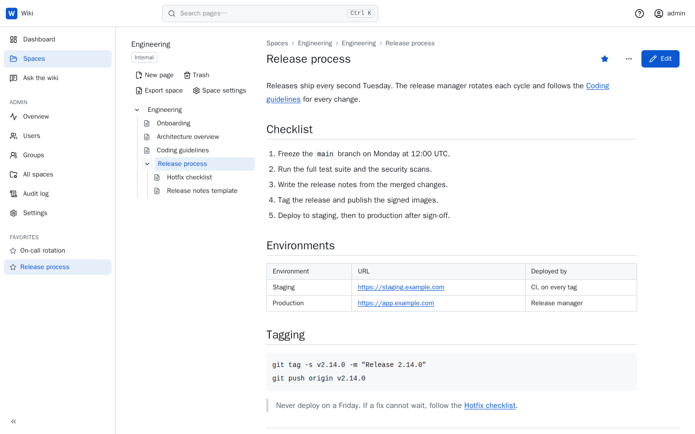
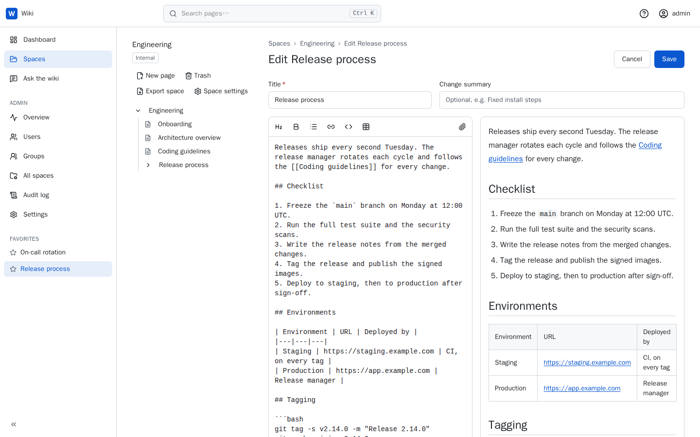
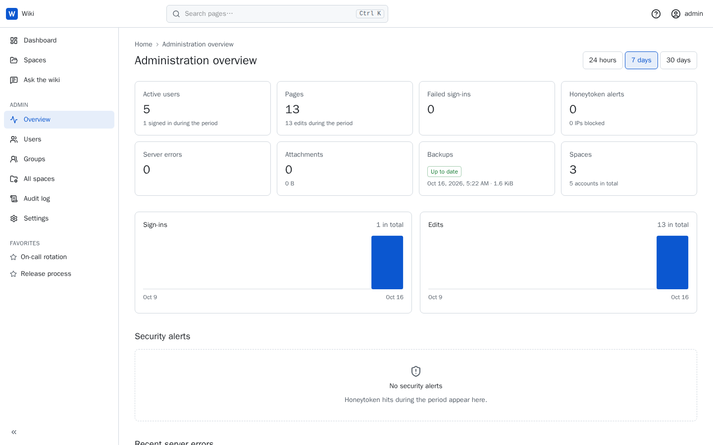
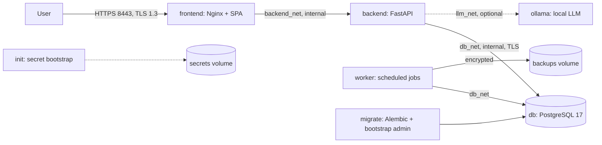

# Wiki

Self-hosted, offline-capable internal wiki where teams write and organize Markdown pages, with history, search and access control.
Example project of [SecSkills](https://github.com/emeryn/SecSkills/tree/main/examples/wiki): built by following its skills (`secure-app-scaffolder`, `offline-llm-orchestrator`, `deep-cleanup`, `project-blueprint`) to show what they produce.



| | |
|---|---|
|  |  |

## Architecture


## Features
- Spaces (restricted or internal) with viewer, editor and space administrator roles for users and groups
- Markdown pages in a tree: split-view editor, `[[Page title]]` links, revisions with diff and restore, edit conflict detection, trash, favorites, recent changes
- Full-text search filtered by permissions, attachments (images, PDF, Office, text) and Markdown zip export
- Local accounts (Argon2id, NIST SP 800-63B policy, bundled common-password list) and single sign-on: OpenID Connect and LDAPS/StartTLS with group-to-space-role mapping and auto-provisioning
- Two-factor authentication: authenticator apps (TOTP), security keys and passkeys (WebAuthn), recovery codes; mandatory for administrators
- Administration of users (invitation and reset links, roles, disabling, MFA reset) and groups; tamper-evident audit trail (hash chain) with a filterable viewer and CSV export
- Ask the wiki: answers from the pages each user can read, with sources, streamed from a local LLM (Ollama, pgvector); MCP endpoints (`/mcp`, `/mcp/admin`) for AI clients with personal API keys
- Operations: admin dashboard, remote syslog (RFC 5424/5425), SMTPS and signed webhook notifications, honeytokens with IP blocking, encrypted daily backups with a restore test, embedded help

## Quick Start
```bash
git clone https://github.com/emeryn/SecSkills.git && cd SecSkills/examples/wiki
docker compose up -d
```
Equivalents: `podman compose up -d` (rootless), `make up`. The first start builds the images (a few minutes); only Docker or Podman is needed. Open https://localhost:8443 (the browser warns: the certificate comes from the generated internal CA) and sign in as `admin` with the password printed by `docker compose exec backend python -m app.cli admin-password`; you then choose a new password and enroll a second factor.

## Deployment
| Target | Commands |
|---|---|
| Docker | `export FRONTEND_BIND_ADDRESS=0.0.0.0 BACKEND_PUBLIC_URL=https://wiki.example.com:8443`<br>`make build`<br>`docker compose up -d`<br>`make import-tls CERT=fullchain.pem KEY=privkey.pem`<br>`make smoke` |
| Podman (rootless) | `export FRONTEND_BIND_ADDRESS=0.0.0.0 BACKEND_PUBLIC_URL=https://wiki.example.com:8443`<br>`podman compose build`<br>`podman compose up -d` |

`make build` fails if `npm audit` or `pip-audit` reports a high or critical vulnerability. Email, syslog and webhooks need `-f deploy/compose.egress.yml`: backend and worker have no outbound route otherwise. `-f deploy/compose.llm.yml` adds a local Ollama for Ask the wiki (see the admin help). Copy `app/backup.key` and `app/master.key` from the `secrets` volume to a safe place, apart from the backups. Without `make`, see the equivalents under Development.

## Configuration
Every variable is optional; see `.env.example`. Secrets are never configured here.

| Variable | Default | Description |
|---|---|---|
| `FRONTEND_BIND_ADDRESS` / `FRONTEND_PORT` | `127.0.0.1` / `8443` | Address and port HTTPS is published on |
| `BACKEND_IMAGE` / `FRONTEND_IMAGE` / `DB_IMAGE` | `wiki-backend` / `wiki-frontend` / `wiki-db` | Image references (registry paths for signed images) |
| `BACKEND_PUBLIC_URL` | `https://localhost:<FRONTEND_PORT>` | URL users open: CSRF origin check, WebAuthn, emailed links |
| `BACKEND_TLS_HOSTNAMES` | `localhost,127.0.0.1` | Names and IPs in the generated certificate (first start) |
| `BACKEND_LOG_LEVEL` / `BACKEND_ENVIRONMENT` | `INFO` / `production` | `DEBUG`…`CRITICAL` / `production`, `development`, `test` |
| `BACKEND_TRUSTED_PROXY_COUNT` | `1` | Reverse proxies trusted for `X-Forwarded-For` |
| `BACKEND_SECRETS_DIR` | `/run/secrets` | Directory of the file secrets provider |
| `BACKEND_DB_HOST` / `BACKEND_DB_PORT` / `BACKEND_DB_POOL_SIZE` | `db` / `5432` / `5` | PostgreSQL address; connections per process |
| `BACKEND_MAX_REQUEST_BODY_BYTES` | `2097152` | Maximum API request body |
| `BACKEND_API_DOCS_ENABLED` | `false` | Serve `/api/v1/openapi.json` |
| `BACKEND_SESSION_IDLE_MINUTES` / `_ABSOLUTE_HOURS` | `480` / `168` | User session timeouts |
| `BACKEND_ADMIN_SESSION_IDLE_MINUTES` / `_ABSOLUTE_HOURS` | `60` / `8` | Administrator session timeouts (maximums) |
| `BACKEND_REAUTH_WINDOW_MINUTES` | `5` | Validity of a step-up confirmation for sensitive actions |
| `BACKEND_SMTP_HOST` / `_PORT` / `_FROM` / `_USERNAME` / `_PASSWORD_FILE` | unset / `465` / `wiki@localhost` / unset / unset | SMTPS server and password file; when set, overrides the admin UI email settings |
| `BACKEND_OIDC_*` (`ENABLED`, `ISSUER`, `CLIENT_ID`, `CLIENT_SECRET_FILE`, `SCOPES`, `ID_TOKEN_ALGORITHM`, `*_CLAIM`, `AUTO_PROVISION`, `GROUP_MAPPING`, `ADMIN_GROUPS`, `CA_FILE`…) | unset | OpenID Connect; a variable set here is read-only in the admin UI (full list in `.env.example`) |
| `BACKEND_LDAP_*` (`ENABLED`, `URL`, `START_TLS`, `BIND_DN`, `BIND_PASSWORD_FILE`, `*_BASE_DN`, `*_FILTER`, `*_ATTRIBUTE`, `AUTO_PROVISION`, `GROUP_MAPPING`, `ADMIN_GROUPS`, `CA_FILE`) | unset | LDAP directory sign-in, same rules; secrets mounted with `deploy/compose.sso.yml` |
| `BACKEND_WORKER_INTERVAL_SECONDS` | `600` | Interval of the purge jobs |
| `BACKEND_INACTIVE_ACCOUNT_DAYS` | `180` | Disable accounts without sign-in for this long (`0`: never; the last admin is kept) |
| `BACKEND_BACKUP_INTERVAL_HOURS` / `_RETENTION_COUNT` / `BACKEND_BACKUPS_DIR` | `24` / `14` / `/var/lib/wiki/backups` | Encrypted backups (`0`: on demand only) |
| `BACKEND_ATTACHMENTS_DIR` / `BACKEND_MAX_ATTACHMENT_BYTES` | `/var/lib/wiki/attachments` / `10485760` | Attachment storage (the `attachments` volume) and maximum size |
| `NPM_REGISTRY` / `UV_INDEX_URL` | public registries | Build-time mirrors for offline builds (build args) |

## API
| Method | Path | Auth | Description |
|---|---|---|---|
| GET | `/api/v1/health` | none | Database reachability |
| POST | `/api/v1/auth/login`, `/auth/mfa/{totp,recovery,webauthn}`, `/auth/password-reset[/confirm]` | none / pending session | Sign-in steps (return the next state and a CSRF token); reset by email, set a password from a reset or invitation link |
| GET / POST | `/api/v1/auth/session`, `/auth/logout`, `/auth/reauth` | session | Current session, sign-out, step-up confirmation |
| POST / GET / DELETE | `/api/v1/me/password`, `/me/mfa/*`, `/me/sessions/*` | session | Own password, second factors, sessions |
| GET / POST / PATCH | `/api/v1/admin/users[/{id}]`, `.../reset-link`, `.../revoke-sessions`, `.../reset-mfa` | admin | User administration |
| GET / POST / PATCH / PUT / DELETE | `/api/v1/admin/groups[/{id}[/members/{user_id}]]` | admin | Groups and members |
| GET / POST | `/api/v1/spaces`, `/admin/spaces` | session / admin | Readable spaces; create a space; all spaces (admin) |
| GET / PATCH / DELETE | `/api/v1/spaces/{space}`, `.../members/{type}/{id}` | viewer / space admin | Space settings, archiving, members |
| GET / POST / PUT / DELETE | `/api/v1/spaces/{space}/pages[/{id}]`, `.../move`, `.../by-slug/{slug}` | viewer / editor | Page tree and pages; `PUT` requires `If-Match` (`412` when stale) |
| GET / POST | `/api/v1/spaces/{space}/pages/{id}/revisions[/{rev}[/diff\|/restore]]` | viewer / editor | History, diff, restore |
| GET / POST / DELETE | `/api/v1/spaces/{space}/trash[/{id}[/restore]]` | editor / space admin | Trash (30 days) |
| GET / PUT / DELETE | `/api/v1/recent-changes`, `/me/favorites[/{page_id}]`, `/search?q=` | session | Feeds and full-text search filtered to readable spaces; snippets as plain-text segments |
| GET / POST / DELETE | `/api/v1/spaces/{space}/pages/{id}/attachments`, `/attachments/{id}` | viewer / editor | Upload (multipart, 10 MB), download, delete |
| GET | `/api/v1/spaces/{space}/export[?page=]` | viewer | Markdown zip of a page subtree or the whole space (step-up) |
| GET | `/api/v1/auth/methods`, `/auth/oidc/start`, `/auth/oidc/callback`, `/auth/oidc/reauth` | none / session | Sign-in methods; OIDC redirects (code + PKCE) and SSO step-up |
| GET / POST | `/api/v1/ask/status`, `/api/v1/ask`, `/admin/llm/models`, `/admin/llm/prompt` | session / admin | Ask the wiki (SSE stream), models, versioned system prompt |
| GET / POST / DELETE | `/api/v1/me/api-keys[/{id}]`; `POST /mcp`, `POST /mcp/admin` (JSON-RPC) | session (step-up to create) / API key | API keys; MCP tools `search_pages`, `read_page`, `create_page`, `update_page` and admin tools |
| GET / PUT / DELETE / POST | `/api/v1/admin/dashboard`, `/admin/audit[/export\|/actions]`, `/admin/settings/{section}[/test]`, `/admin/blocked-ips[/{ip}]` | admin | Dashboard, audit viewer and CSV export (step-up), settings, unblocking |

Errors always use `{"error": {"code", "message", "request_id"}}`. Writes require `X-Requested-With`, the session CSRF token (`X-CSRF-Token`) and an `Idempotency-Key`.

## Security
- Rootless containers with numeric users, read-only root filesystems, all capabilities dropped, `no-new-privileges`, PID and memory limits, core dumps disabled; no shell or package manager in the backend and web images; process execution blocked in the API by an in-process seccomp filter; base images pinned by digest; lockfiles enforced; dependency audits gate `make build`
- Only the reverse proxy publishes a port; backend and database networks are internal; TLS 1.3 only with hybrid post-quantum key exchange (`X25519MLKEM768`), HSTS, strict CSP with Trusted Types
- PostgreSQL: `scram-sha-256` over TLS 1.3 with certificate and host name verification; DML-only runtime role with statement timeout; superuser reachable only through the local socket; secrets generated by a one-shot `init` service into a volume, readable only by the service that needs them
- Stored XSS defense: Markdown rendered with HTML disabled, scheme allowlist, DOMPurify with Trusted Types, remote images never loaded; titles of unreadable pages never appear in any feed; LLM answers go through the same sanitizer
- Uploads: extension allowlist and magic bytes, images re-encoded (metadata and polyglots stripped), Office/ODF archives checked for bombs, traversal and macros, SVG/HTML refused, random storage names outside the web root, `nosniff` and sandbox CSP on downloads
- Deny-by-default authorization: every route declares a policy or the app refuses to start; admin rights require MFA in the current session; sensitive actions require a fresh step-up; Ask the wiki retrieves only readable pages (permission filter inside the vector query), passes them as data, offers the model no tools, and pins approved model digests; MCP keys hashed, scoped, expiring, rate limited, every tool call audited, admin endpoint off by default with `confirm` on destructive tools
- `__Host-` session cookie (HttpOnly, Secure, SameSite=Lax) rotated at every privilege change; CSRF token, Origin and Fetch Metadata checks; idempotency store for every write; equal-work sign-in for unknown accounts, progressive delays per account and per IP (no lockout); single-use hashed reset tokens; TOTP replay refused
- SSO: PKCE, single-use `state` and `nonce` bound to the browser, ID token algorithm pinned (never `none`/`HS*`), `iss`/`aud`/`azp`/`exp` checked; identities linked by subject, never by username; LDAP filter values escaped, no unauthenticated bind; admin role only from administrator groups, second factor still required
- Personal data encrypted per record (AES-256-GCM envelope, blind index for email lookup); append-only, hash-chained audit trail (`python -m app.cli audit-verify`)
- JSON logs with request id, CR/LF stripping and redaction of passwords, tokens and session values; optional PII masking; remote syslog over TLS with a bounded buffer
- Outbound URLs (syslog, SMTP, webhooks, LLM) SSRF-checked: https only, metadata/loopback refused, private ranges only if allowlisted, pinned address (DNS rebinding), no redirects; webhooks HMAC-signed
- Honeytokens (decoy accounts, trap URLs) block the client IP and raise a critical alert; backups AES-256-GCM encrypted with a key kept apart, verified by `make restore-test`

### Security & Compliance Scans
| Tool | Version | Target | Result | Date |
|---|---|---|---|---|
| Trivy (vuln, secret, misconfig) | 0.67.2 | `wiki-backend` `sha256:fc55a4b9c452` | 0 critical / 0 high | 2026-10-16 |
| Trivy (vuln, secret, misconfig) | 0.67.2 | `wiki-frontend` `sha256:abeda6005df1` | 0 critical / 0 high | 2026-10-16 |
| Trivy (vuln, secret, misconfig) | 0.67.2 | `wiki-db` `sha256:132e10f5a4b6` | 0 critical / 0 high | 2026-10-16 |
| Trivy config | 0.67.2 | Dockerfiles, compose | 0 critical / 0 high | 2026-10-16 |
| pip-audit / npm audit | pinned in lockfiles | backend / frontend dependencies | 0 known vulnerabilities | 2026-10-16 |
| OpenSCAP | - | images | Not run yet | - |

<details><summary>Nginx configuration (deploy/nginx/nginx.conf)</summary>

```nginx
# Included in the `http` context as /etc/nginx/conf.d/default.conf of nginx-unprivileged.
# X25519MLKEM768 requires OpenSSL >= 3.5 (the pinned image ships 3.5).

server_tokens off;

limit_req_zone $binary_remote_addr zone=api:10m rate=20r/s;
limit_req_zone $binary_remote_addr zone=auth:10m rate=10r/m;
limit_req_zone $binary_remote_addr zone=sensitive:10m rate=6r/m;
limit_req_status 429;

server {
    listen 8443 ssl;
    http2 on;
    server_name _;

    ssl_certificate     /run/secrets/tls/tls.crt;
    ssl_certificate_key /run/secrets/tls/tls.key;
    ssl_protocols       TLSv1.3;
    ssl_ecdh_curve      X25519MLKEM768:X25519:prime256v1;
    ssl_session_cache   shared:TLS:10m;
    ssl_session_timeout 1h;
    ssl_session_tickets off;

    # 10 MB attachments plus the multipart envelope; the API applies tighter per-route limits.
    client_max_body_size  11m;
    client_body_timeout   15s;
    client_header_timeout 15s;
    keepalive_timeout     30s;

    # add_header in a location block drops these headers: never use add_header inside locations.
    add_header Strict-Transport-Security "max-age=63072000; includeSubDomains" always;
    add_header Content-Security-Policy "default-src 'self'; script-src 'self'; style-src 'self'; img-src 'self' data:; font-src 'self'; connect-src 'self'; object-src 'none'; base-uri 'none'; frame-ancestors 'none'; form-action 'self'; require-trusted-types-for 'script'; trusted-types dompurify; upgrade-insecure-requests" always;
    add_header Permissions-Policy "camera=(), microphone=(), geolocation=(), payment=(), usb=()" always;
    add_header X-Content-Type-Options "nosniff" always;
    add_header X-Frame-Options "DENY" always;
    add_header Referrer-Policy "no-referrer" always;
    add_header Cross-Origin-Opener-Policy "same-origin" always;
    add_header Cross-Origin-Resource-Policy "same-origin" always;

    root /usr/share/nginx/html;

    location / {
        try_files $uri /index.html;
        expires -1;
    }

    location /assets/ {
        expires 1y;
    }

    location ~ \.map$ {
        return 404;
    }

    location /api/ {
        limit_req zone=api burst=40 nodelay;
        include /etc/nginx/proxy_backend.conf;
    }

    # Sign-in, MFA, reset and step-up: strict per-IP limit (the API adds per-account delays).
    location /api/v1/auth/ {
        limit_req zone=auth burst=5 nodelay;
        include /etc/nginx/proxy_backend.conf;
    }

    # Audit export and "Send test" are expensive or reach other systems (the API also limits them).
    location ~ ^/api/v1/admin/(audit/export|settings/[a-z]+/test)$ {
        limit_req zone=sensitive burst=3 nodelay;
        include /etc/nginx/proxy_backend.conf;
    }

    # Ask the wiki: streamed answers (server-sent events); the API adds per-user limits.
    location = /api/v1/ask {
        limit_req zone=api burst=10 nodelay;
        include /etc/nginx/proxy_stream.conf;
    }

    # MCP endpoints for AI clients (API keys, no cookies); the API adds per-key limits.
    location = /mcp {
        limit_req zone=api burst=20 nodelay;
        include /etc/nginx/proxy_backend.conf;
    }

    location = /mcp/admin {
        limit_req zone=api burst=20 nodelay;
        include /etc/nginx/proxy_backend.conf;
    }

    # Honeytoken: paths only scanners request. The backend blocks the client IP.
    location ~ ^/(\.env|\.git/|wp-login\.php|wp-admin|phpmyadmin|server-status|actuator) {
        rewrite ^ /api/v1/debug/config break;
        proxy_set_header X-Original-URI $request_uri;
        include /etc/nginx/proxy_backend.conf;
    }

    # Read by the SPA on every navigation: general API limit.
    location = /api/v1/auth/session {
        limit_req zone=api burst=40 nodelay;
        include /etc/nginx/proxy_backend.conf;
    }

    # Sign-in methods, read by the sign-in page: must not consume the sign-in attempt budget.
    location = /api/v1/auth/methods {
        limit_req zone=api burst=40 nodelay;
        include /etc/nginx/proxy_backend.conf;
    }
}
```
</details>

## Development
Only Docker (or Podman) is required; every tool runs in a container.

| Command | Purpose |
|---|---|
| `make dev` | Build and run the stack in the foreground |
| `make test` | Backend tests against an ephemeral PostgreSQL, then frontend tests |
| `make e2e` / `make screenshots` | Playwright tests in Chromium against the running stack (fresh install) / README screenshots from an ephemeral, seeded stack |
| `make lint` / `make format` | ruff, mypy, bandit, ESLint, tsc, Prettier check / format sources in place |
| `make build` | Dependency audits, then image builds |
| `make scan` / `make sbom` | Trivy (+ OpenSCAP) scans / CycloneDX SBOMs and cosign signing |
| `make smoke` | TLS, headers, limits and health checks against the running stack |
| `make admin-password` / `make import-tls` | Bootstrap admin password / install a TLS certificate |
| `make backup` / `make restore-test` | Encrypted backup now / restore the newest backup into a scratch database and verify it |
| `make clean-prod` | gitleaks on tree and history before release |

<details><summary>Without make</summary>

| Target | Equivalent |
|---|---|
| `up` / `down` / `logs` / `dev` | `docker compose up -d` / `docker compose down` / `docker compose logs -f` / `docker compose up --build` |
| `build` | `docker build -f backend/Dockerfile --target audit .`, `docker build -f frontend/Dockerfile --target audit .`, then `docker compose build` |
| `admin-password` | `docker compose exec backend python -m app.cli admin-password` |
| `backup` | `docker compose exec worker python -m app.cli backup` |
| `import-tls` | `docker compose run --rm --no-deps -v "$PWD/fullchain.pem:/import/tls.crt:ro" -v "$PWD/privkey.pem:/import/tls.key:ro" init python -m app.cli import-tls --cert /import/tls.crt --key /import/tls.key`, then `docker compose restart frontend` |
| `test`, `scan`, `sbom`, `smoke`, `e2e`, `screenshots`, `restore-test`, `clean-prod` | `sh scripts/<target>.sh` (any POSIX shell: Linux, macOS, Git Bash or WSL on Windows) |
| `lint` / `format` | The `docker build` and `docker run` commands of the same target in the `Makefile` |

With Podman, use `podman compose` and `podman`; the scripts call `docker` (the `podman-docker` package provides it).
</details>

## Project Structure
```
backend/    FastAPI app (app/), Alembic migrations, tests
frontend/   React + TypeScript SPA (src/), served by Nginx
deploy/     nginx/ (reverse proxy), postgres/ (TLS, roles, pg_hba)
docs/       specification, architecture, implementation plan, security/, help/ (embedded help), screenshots/
scripts/    scan, sbom, clean-prod, smoke, e2e, screenshots, restore-test (called by the Makefile)
```
