# Architecture: Wiki

Target layout and data model for v1. Folders are created when their first file is written; no empty placeholders.

## Directory tree
```
wiki/
├── README.md
├── Makefile                         # help dev up down logs test lint format build scan sbom
│                                    # clean-prod screenshots admin-password backup restore-test
├── docker-compose.yml               # init, db, migrate, backend, worker, frontend (only frontend publishes a port)
├── .env.example
├── .editorconfig  .gitignore  .dockerignore  .pre-commit-config.yaml  .npmrc
├── frontend/
│   ├── Dockerfile                   # build stage → nginx-unprivileged, USER 101:101
│   ├── package.json  package-lock.json  tsconfig.json  vite.config.ts  eslint.config.js
│   ├── public/                      # favicon, bundled Inter font
│   ├── src/
│   │   ├── main.tsx
│   │   ├── app/                     # router.tsx, providers.tsx, AppShell.tsx, ErrorBoundary.tsx
│   │   ├── features/
│   │   │   ├── auth/                # sign-in, MFA challenge, reset, first-login enrollment
│   │   │   ├── account/             # profile, password, MFA devices, active sessions
│   │   │   ├── dashboard/           # favorites, recent changes, my spaces
│   │   │   ├── spaces/              # list, space home, page tree sidebar, members, settings
│   │   │   ├── pages/               # rendered page, move dialog, delete, export
│   │   │   ├── editor/              # split view, toolbar, Ctrl+S, unsaved warning, 412 merge
│   │   │   ├── history/             # revision list, diff view, restore
│   │   │   ├── trash/
│   │   │   ├── attachments/
│   │   │   ├── search/
│   │   │   ├── favorites/
│   │   │   ├── help/                # renders bundled docs/help
│   │   │   ├── ask/                 # Ask the wiki: streamed answers, sources
│   │   │   └── admin/               # users, groups, spaces, settings, audit, dashboard
│   │   ├── components/ui/           # Radix/shadcn primitives, DataTable, ConfirmDialog
│   │   ├── lib/                     # api-client.ts, auth.ts, config.ts, i18n.ts, format.ts,
│   │   │                            # markdown.ts (markdown-it + DOMPurify + Trusted Types policy)
│   │   ├── locales/en.json
│   │   └── styles/                  # tokens.css, global.css
│   └── e2e/                         # Playwright specs, fixtures/, screenshots.spec.ts
├── backend/
│   ├── Dockerfile                   # uv build stage → distroless Python, USER 10001:10001
│   ├── pyproject.toml  uv.lock
│   ├── app/
│   │   ├── main.py                  # app factory only
│   │   ├── worker.py                # scheduled jobs: hygiene, dormant accounts, backups, embeddings
│   │   ├── llm/                     # provider.py (LLMProvider), ollama.py, prompts/*.md
│   │   ├── mcp/                     # server.py (JSON-RPC), tools.py, admin_tools.py
│   │   ├── api/v1/
│   │   │   ├── auth.py  me.py  favorites.py
│   │   │   ├── spaces.py  members.py  pages.py  revisions.py  trash.py
│   │   │   ├── attachments.py  search.py  export.py  recent_changes.py
│   │   │   ├── sso.py               # sign-in methods, OIDC start/callback/step-up
│   │   │   ├── trap.py              # honeytoken endpoint
│   │   │   └── admin/               # users.py groups.py spaces.py settings.py audit.py dashboard.py
│   │   │                            # security.py (blocked IPs)
│   │   ├── core/                    # config.py db.py logging.py security.py secrets.py
│   │   │                            # crypto.py csrf.py idempotency.py permissions.py
│   │   │                            # rate_limit.py sandbox.py (execve seccomp) bootstrap.py
│   │   │                            # outbound_url.py (SSRF) mailer.py runtime_settings.py
│   │   │                            # ip_blocklist.py outbound_http.py sso_env.py
│   │   ├── models/                  # one module per aggregate
│   │   ├── schemas/                 # Pydantic, extra="forbid", max lengths
│   │   ├── services/                # auth_service, mfa_service, page_service, revision_service,
│   │   │                            # slug.py, link_resolver.py, diff.py, search_service,
│   │   │                            # attachment_service, image_reencoder.py, export_service,
│   │   │                            # audit_service, audit_export, settings_service, notifier,
│   │   │                            # webhook, syslog_forwarder, honeytoken_service, dashboard,
│   │   │                            # backup_archive, backup_service, restore_test, account_hygiene,
│   │   │                            # oidc_service, ldap_service, sso_config, sso_provisioning,
│   │   │                            # llm_config, rag_indexer, ask_service, prompt_service
│   │   └── repositories/            # every query filtered by readable spaces
│   ├── migrations/                  # Alembic
│   ├── data/breached-passwords.txt.gz
│   └── tests/                       # mirrors app/, plus tests/security/ (mandatory matrix)
├── deploy/
│   ├── nginx/nginx.conf
│   └── postgres/                    # postgresql.conf, pg_hba.conf (scram-sha-256, hostssl only)
├── docs/
│   ├── specification.md
│   ├── architecture.md
│   ├── implementation-plan.md
│   ├── screenshots/
│   ├── help/                        # user/ and admin/ Markdown
│   └── security/                    # threat-model.md, authentication-flows.md
└── scripts/                         # clean-prod.sh scan.sh sbom.sh smoke.sh e2e.sh restore-test.sh
```

`worker` is the backend image started with a different command; it holds no published port.

## Data model
Permissions are space-level only (no per-page ACL). `restricted` spaces are readable by members; `internal` spaces by every authenticated user. PII (`email`, `display_name`, TOTP secret, settings secrets) is encrypted with a per-record DEK; `email_bidx` is the HMAC blind index used for login lookup and uniqueness.

```mermaid
erDiagram
    users ||--o{ group_members : "belongs to"
    groups ||--o{ group_members : has
    users ||--o{ sessions : owns
    users ||--o| totp_credentials : enrolls
    users ||--o{ webauthn_credentials : enrolls
    users ||--o{ recovery_codes : holds
    users ||--o{ password_reset_tokens : requests
    users ||--o{ known_devices : "signs in from"
    spaces ||--o{ space_members : grants
    users ||--o{ space_members : "principal (user)"
    groups ||--o{ space_members : "principal (group)"
    spaces ||--o{ pages : contains
    pages ||--o{ pages : "parent of"
    pages ||--o{ revisions : "has history"
    pages ||--|| revisions : "current revision"
    users ||--o{ revisions : authors
    pages ||--o{ attachments : has
    users ||--o{ favorites : stars
    pages ||--o{ favorites : "starred in"
    users ||--o{ idempotency_keys : sends
    users ||--o{ audit_events : "acts in"

    users {
        uuid id PK
        text username UK
        bytea email_enc
        bytea email_bidx UK
        bytea display_name_enc
        bytea dek_wrapped
        int key_version
        text password_hash "Argon2id, null for SSO"
        text auth_source "local|oidc|ldap"
        text external_id "OIDC sub or directory entryUUID, unique per source"
        text global_role "user|admin"
        bool must_reset_password
        timestamptz last_login_at
        timestamptz disabled_at
        timestamptz created_at
    }
    groups {
        uuid id PK
        text name UK
        text source "local|oidc|ldap"
        text external_ref
    }
    group_members {
        uuid group_id PK,FK
        uuid user_id PK,FK
    }
    sessions {
        uuid id PK
        bytea token_hash UK
        uuid user_id FK
        inet ip
        text user_agent
        timestamptz created_at
        timestamptz last_seen_at
        timestamptz idle_expires_at
        timestamptz absolute_expires_at
        timestamptz mfa_verified_at
        timestamptz reauth_at
        timestamptz revoked_at
    }
    totp_credentials {
        uuid user_id PK,FK
        bytea secret_enc
        bigint last_used_step "replay guard"
        timestamptz confirmed_at
    }
    webauthn_credentials {
        uuid id PK
        uuid user_id FK
        bytea credential_id UK
        bytea public_key
        bigint sign_count
        text name
        timestamptz last_used_at
    }
    recovery_codes {
        uuid id PK
        uuid user_id FK
        text code_hash
        timestamptz used_at
    }
    password_reset_tokens {
        uuid id PK
        uuid user_id FK
        bytea token_hash UK
        timestamptz expires_at
        timestamptz used_at
    }
    known_devices {
        uuid id PK
        uuid user_id FK
        bytea fingerprint_hash
        timestamptz first_seen_at
        timestamptz last_seen_at
    }
    spaces {
        uuid id PK
        text key UK "URL segment, a-z0-9-"
        text name
        text description
        text visibility "restricted|internal"
        uuid home_page_id FK
        timestamptz archived_at
        uuid created_by FK
        timestamptz created_at
    }
    space_members {
        uuid space_id PK,FK
        text principal_type PK "user|group"
        uuid principal_id PK
        text role "viewer|editor|space_admin"
        text source "manual|sso"
    }
    pages {
        uuid id PK
        uuid space_id FK
        uuid parent_id FK
        text slug "unique per space among live pages"
        text title
        text title_norm "link resolution"
        uuid current_revision_id FK "deferrable"
        int position "among siblings"
        smallint depth "1..5"
        timestamptz deleted_at
        uuid deleted_by FK
        uuid trash_root_id "page the user deleted"
        tsvector search_vector "GIN, title A + body B"
        timestamptz created_at
        timestamptz updated_at
    }
    revisions {
        uuid id PK
        uuid page_id FK
        uuid author_id FK
        text title
        text body "max 1 MB"
        text message "max 500"
        uuid restored_from_id FK
        timestamptz created_at
    }
    attachments {
        uuid id PK
        uuid page_id FK
        uuid uploaded_by FK
        text filename "sanitized"
        text storage_key UK "random, outside web root"
        text content_type "from the allowlist"
        int size_bytes
        text sha256
        bool inline_allowed "re-encoded raster only"
        timestamptz created_at
    }
    favorites {
        uuid user_id PK,FK
        uuid page_id PK,FK
        timestamptz created_at
    }
    idempotency_keys {
        uuid user_id PK,FK
        uuid key PK
        bytea request_hash
        smallint status_code
        jsonb response_body
        timestamptz expires_at
    }
    audit_events {
        bigint id PK
        timestamptz occurred_at
        uuid actor_user_id FK
        inet actor_ip
        text user_agent
        text action
        text outcome "success|failure"
        text severity "info|warning|critical"
        text target_type
        uuid target_id
        uuid space_id
        jsonb before
        jsonb after
        text request_id
        bytea prev_hash
        bytea hash
    }
    settings {
        text key PK "section: syslog, smtp, webhook..."
        bytea value_enc "JSON, secrets included"
        bytea dek_wrapped
        int key_version
        uuid updated_by FK
        timestamptz updated_at
    }
    server_errors {
        bigint id PK
        timestamptz occurred_at
        text source "request|job"
        text method
        text path
        smallint status
        text request_id
    }
    auth_throttle {
        text subject PK "account or IP"
        int failures
        timestamptz next_allowed_at
    }
    blocked_ips {
        inet ip PK
        text reason
        int hits
        timestamptz blocked_at
        timestamptz expires_at
    }
```



Notes:
- `pages.search_vector` is rebuilt on every saved revision (`simple` configuration: no stemming, any language).
- Attachment bytes live in the `attachments` volume; the worker removes files whose row is gone.
- `[[Title]]` links are resolved when rendering, against the titles of the same space (no link table).
- Slugs are unique per space, trashed pages included; titles are unique among live pages (`title_norm`).
- A deleted page and its subtree share `trash_root_id`, so they are restored or purged together.
- Runtime role: `INSERT`/`SELECT` only on `audit_events`; no `UPDATE`/`DELETE`.
- `api_keys (user_id, name, prefix, key_hash, scopes, expires_at, last_used_at, last_used_ip, revoked_at)`: MCP keys, hashed with SHA-256; the secret is never stored.
- `pages.current_revision_id` and `spaces.home_page_id` are deferrable so a backup restores table by table.
- `page_chunks (page_id, space_id, revision_id, ordinal, content, model, embedding vector)`: re-created for each new current revision by the worker, deleted with the page; `llm_prompts` keeps every system prompt version; `llm_usage (user_id, day)` counts tokens for the quota.
- `oidc_flows` holds pending OIDC authorizations: state hash, browser binding hash, nonce, PKCE verifier (single use, 10 minutes, purged by the worker).
- Backups (`backups` volume) hold every table except sessions, idempotency keys, throttling and reset tokens, plus attachment files.
