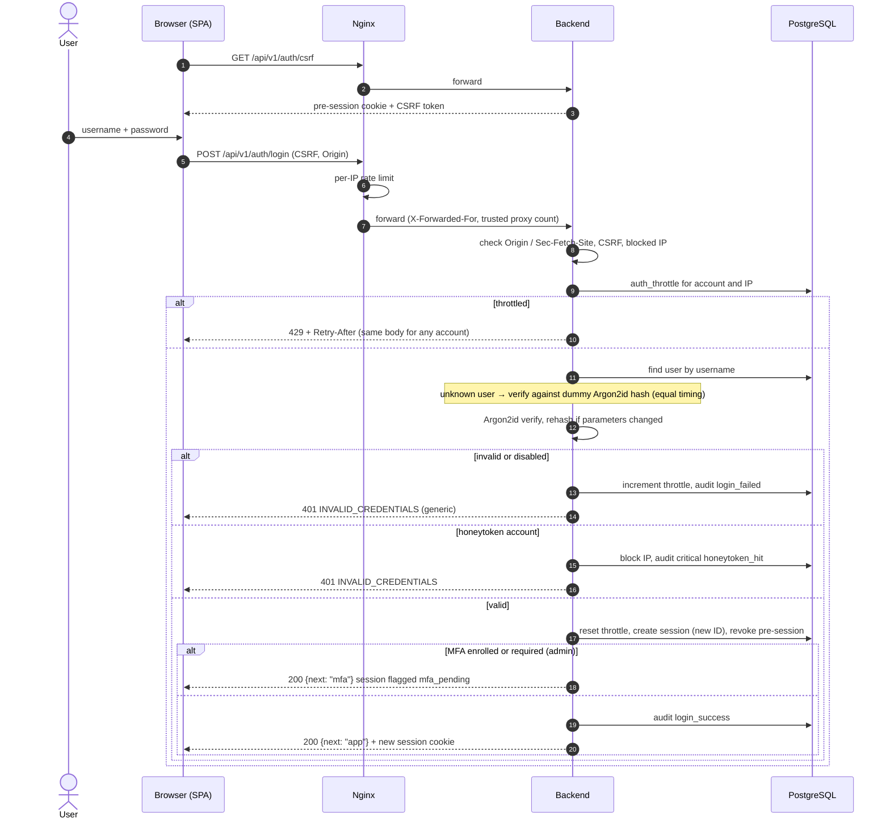
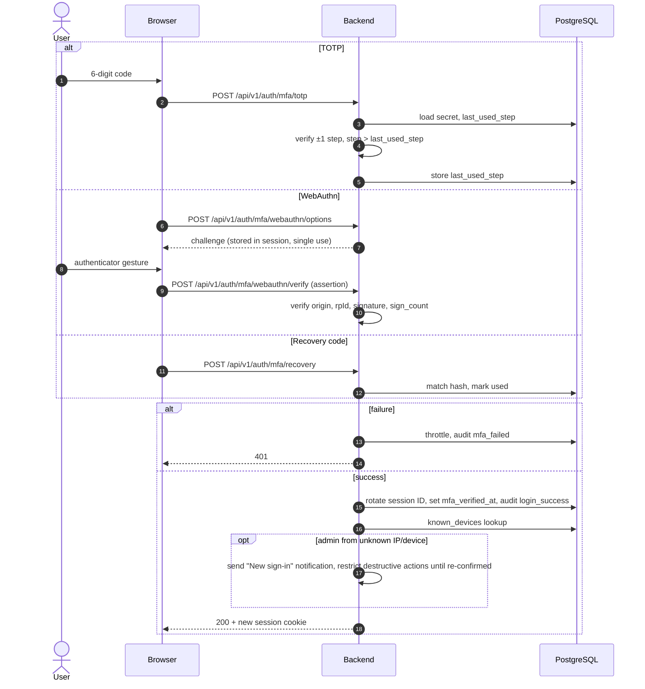
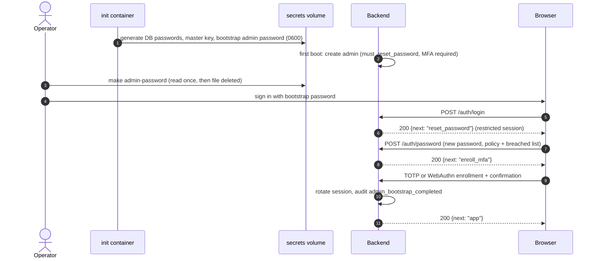
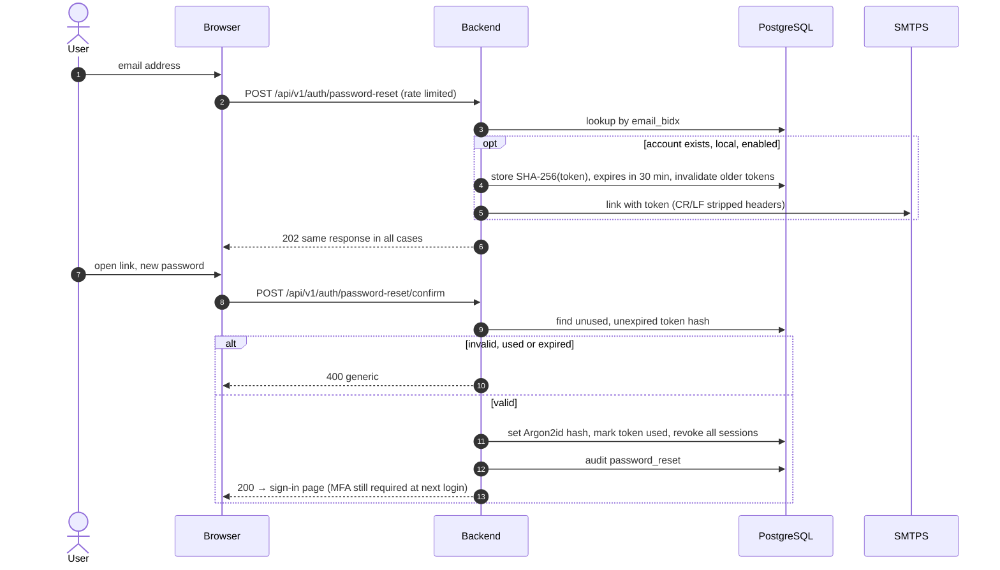
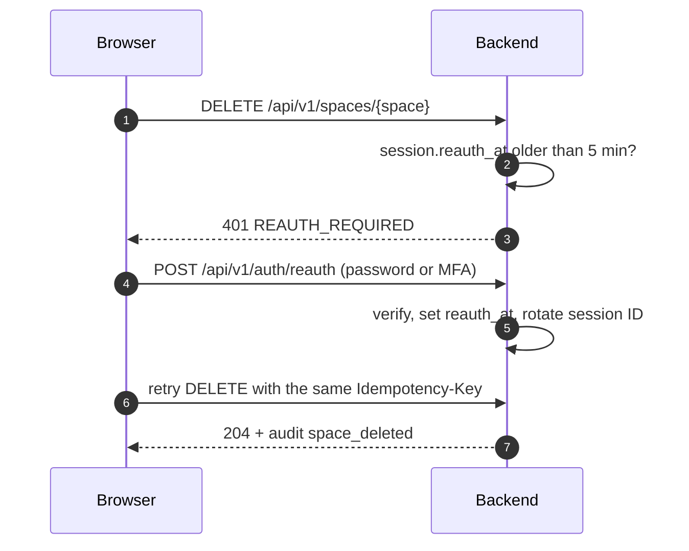
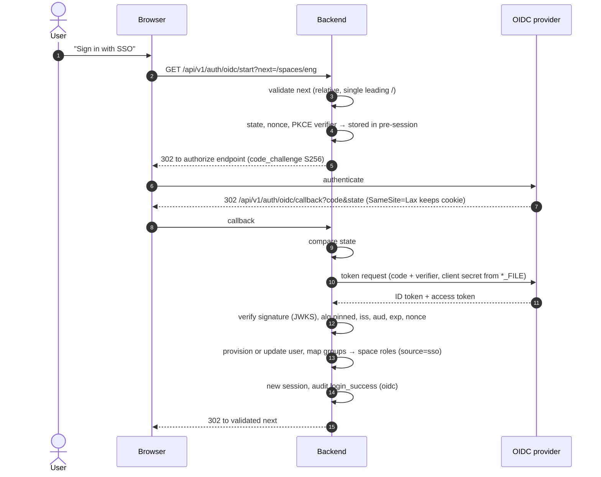

# Authentication Flows

All flows go through Nginx (TLS, rate limits). Every state-changing request carries the CSRF token, `X-Requested-With` and an `Idempotency-Key`. Session cookie: `__Host-session; HttpOnly; Secure; SameSite=Lax; Path=/`.

## 1. Local sign-in

## 2. MFA challenge (TOTP or WebAuthn)

## 3. Bootstrap admin first sign-in

## 4. Password reset

## 5. Step-up re-authentication (sensitive actions)
Applies to: space deletion, export of a whole space, membership/role changes by admins, user deletion, MFA changes.

## 6. OIDC sign-in (optional extension)

LDAPS follows flow 1 with the password check replaced by: service bind → escaped user filter search → user bind over LDAPS (certificate verified) → group search → role mapping.
